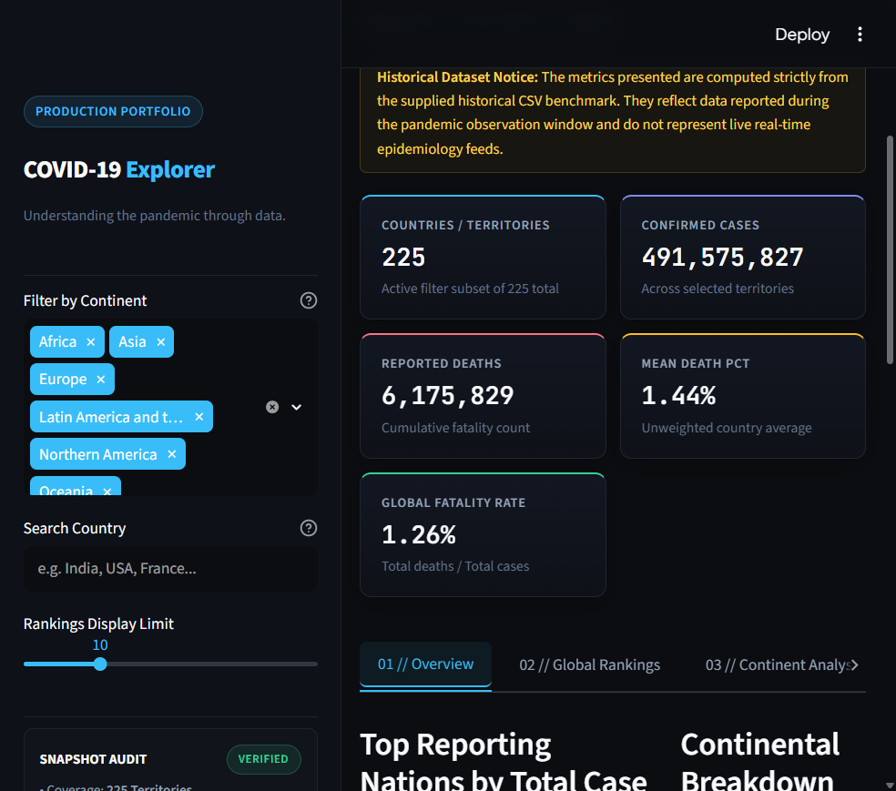
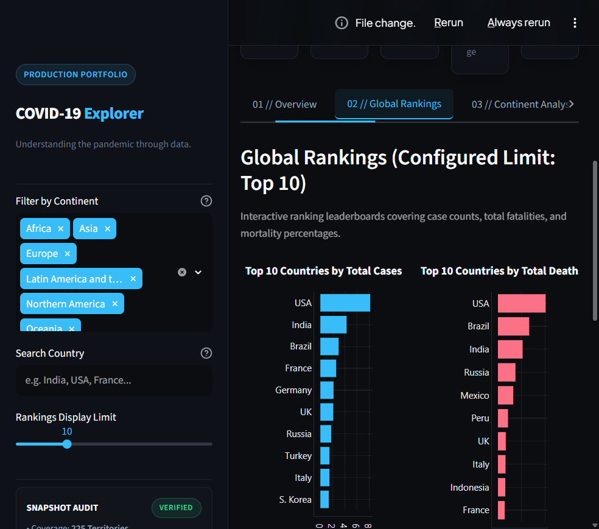
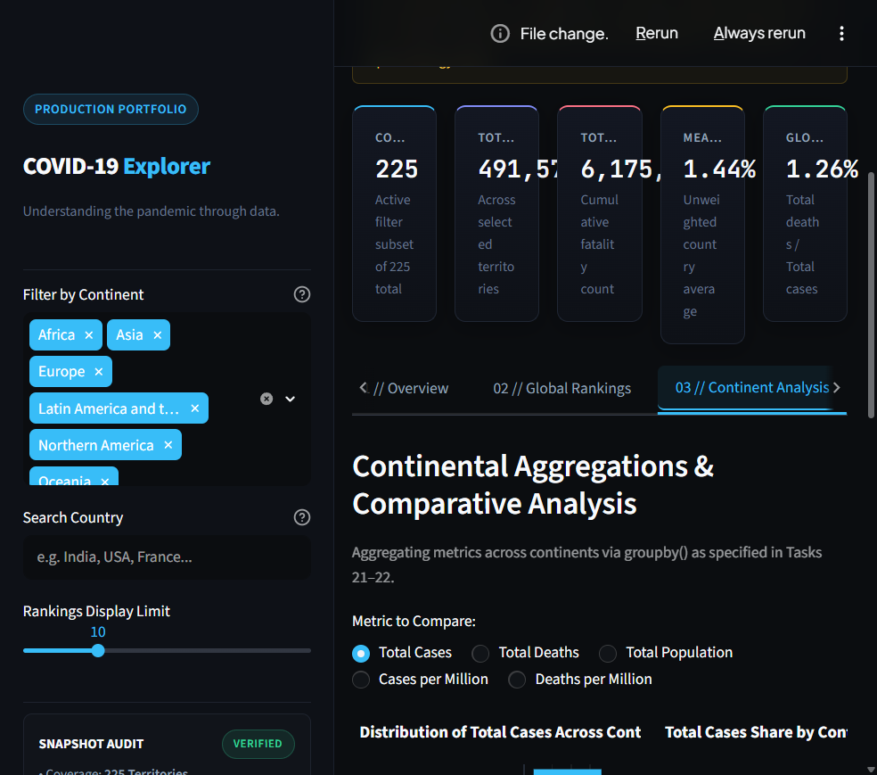
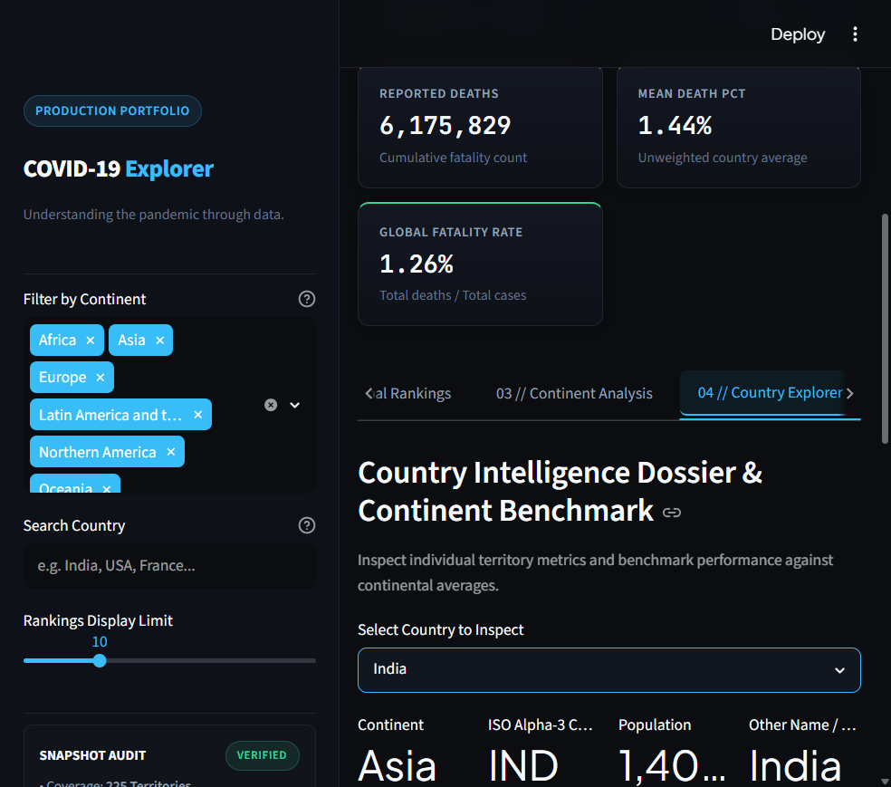
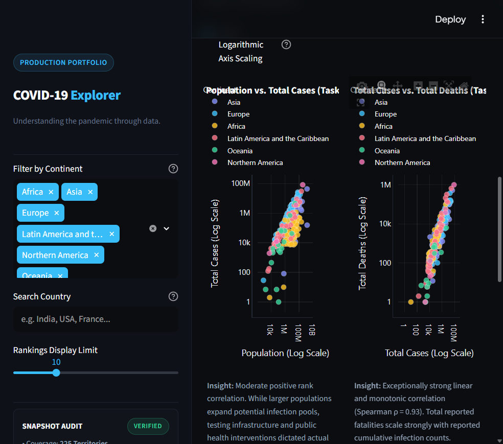
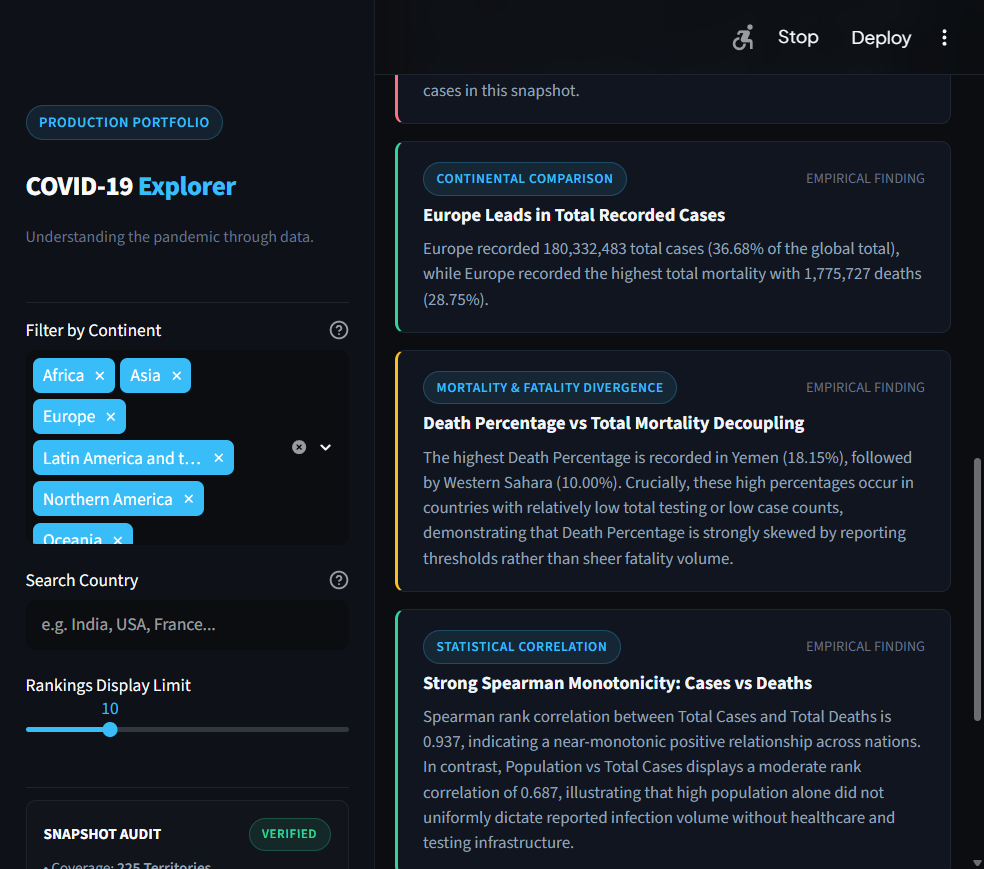
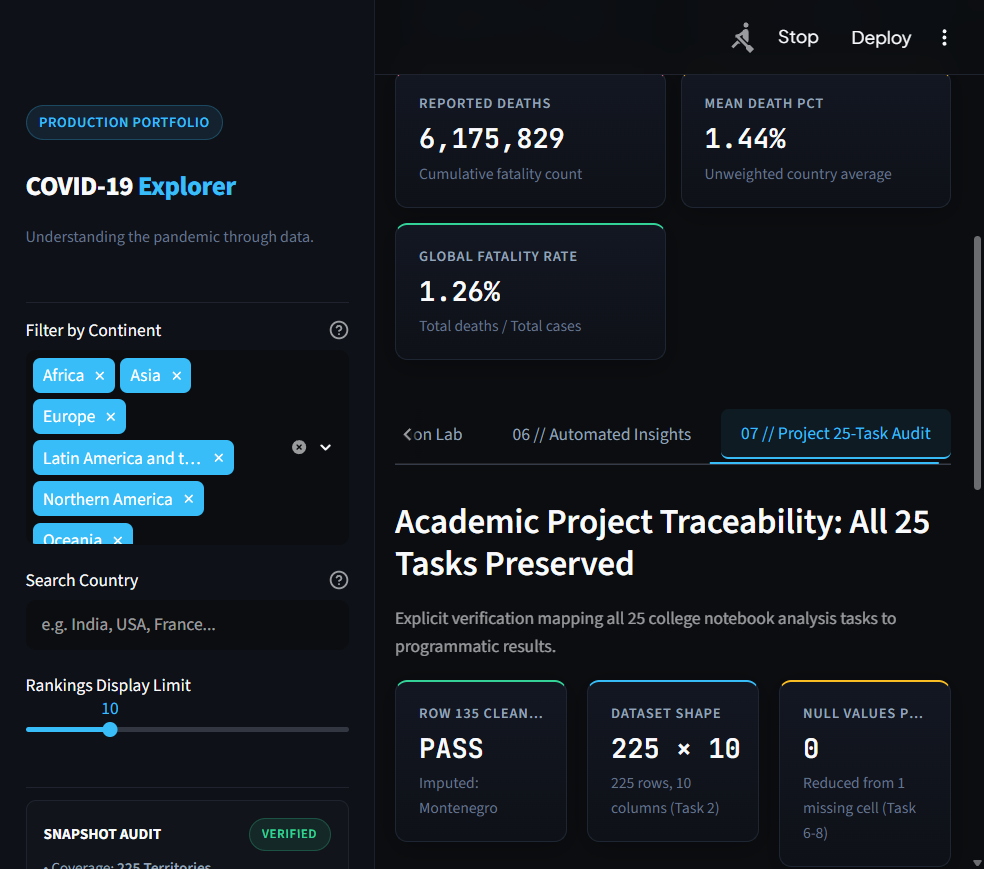

# COVID-19 Data Explorer

> **Understanding the pandemic through data.**  
> A high-performance, dark-first editorial analytics dashboard built with Python, Streamlit, Plotly, and Pandas. Transforms exploratory data analysis into a production-grade macroeconomic & epidemiological intelligence platform.

[](https://www.python.org/)
[](https://streamlit.io/)
[](https://plotly.com/)
[](LICENSE)
[]()

---

## 🧭 Project Overview

**COVID-19 Data Explorer** is an end-to-end data analytics and visualization system designed to explore global COVID-19 trends across 225 countries and territories. Originally developed as an exploratory data analysis project with 25 required analytical tasks, this repository re-architects the workflow into a modular, production-ready analytics suite featuring:

- **Editorial UI/UX Design**: Inspired by Linear, Vercel, and Bloomberg Terminal interfaces. Uses a near-black palette (`#0B0D10`), subtle borders, responsive KPI cards, and custom typography.
- **Complete Task Traceability**: Preserves 100% of the 25 original academic tasks while introducing interactive drilldowns, logarithmic scales, and continental benchmarks.
- **Reproducible Data Pipeline**: Deterministic imputation of missing values (imputing `Montenegro` for row 135) and ISO code standardization.
- **Zero-Dependency Deployment**: Ready for instant one-click deployment on Streamlit Community Cloud without external databases or secrets.

> ⚠️ **Dataset Notice**: This platform is evaluated against a static historical snapshot dataset (`COVID-19 Coronavirus.csv`) covering the 2020–2022 pandemic observation period. Metrics illustrate historical reported totals and do not represent live real-time epidemiology feeds.

---

## 📸 Dashboard Screenshots

### 1. Overview & Macro Key Performance Indicators
*Top-level KPI cards with responsive grid wrapping, country search, continental case distribution, and executive findings.*


### 2. Global Rankings & Leaderboards
*Comparative horizontal bar charts for Top 10 cases, Top 10 fatalities, lowest case counts, and highest death percentages.*


### 3. Continental Aggregations & Distribution
*Groupby aggregations, comparative distribution charts, share percentages, and continent summary table.*


### 4. Country Intelligence Dossier & Benchmark
*Territory profile benchmarking chosen country against its continental average with rank metrics.*


### 5. Correlation Lab & Spearman Rank Matrix
*Logarithmic scatter plots and annotated Spearman rank correlation heatmap.*


### 6. Automated Empirical Insights
*Strictly factual observations synthesized deterministically from the dataset.*


### 7. Academic Traceability & Static Figure Gallery
*Formal verification matrix mapping Tasks 01–25 alongside high-resolution Matplotlib/Seaborn output figures.*


---

## ✨ Key Features

1. **Overview Dashboard**
   - High-density KPI cards: Total Territories (225), Confirmed Cases (491.5M), Total Deaths (6.18M), Mean Death Percentage (1.44%), and Global Fatality Rate (1.26%).
   - Multi-select continent filtering and real-time substring country search.
   - Executive insight highlights summarizing statistical skewness and reporting patterns.

2. **Global Rankings (Tasks 12–20)**
   - Top $N$ countries by total confirmed cases.
   - Top $N$ countries by cumulative mortality.
   - Bottom $N$ countries by lowest reported cases and deaths.
   - Highest death percentage rankings with contextual callouts on small-denominator testing bias.
   - Dynamic slider to adjust display depth from 5 to 25 countries.

3. **Continental Analysis (Tasks 21–22)**
   - Grouped aggregations across Africa, Asia, Europe, Latin America & Caribbean, Northern America, and Oceania.
   - Metric toggles: Total Cases, Total Deaths, Population, Cases/Million, and Deaths/Million.
   - Global percentage share calculations and interactive donut charts.

4. **Country Explorer & Benchmarking**
   - Single-country deep dive: Population, Cases, Deaths, Cases/1M, Deaths/1M, Death Percentage.
   - Continental rank and global rank out of 225 territories.
   - Relative benchmark chart comparing the country against continental baseline (100% benchmark).

5. **Correlation Lab (Tasks 23–25)**
   - Population vs. Total Cases scatter plot with optional logarithmic scaling.
   - Total Cases vs. Total Deaths scatter plot demonstrating strong monotonic association ($\rho = 0.93$).
   - Interactive Spearman rank correlation matrix heatmap with exact coefficients.

6. **Automated Empirical Insights**
   - Purely factual data synthesis engine without hallucinations or speculative numbers.
   - Highlights concentration among top nations, reporting artifacts, and correlation properties.

7. **25-Task Academic Audit & Output Gallery**
   - Interactive checklist confirming all 25 tasks from the project brief.
   - Verified row 135 data imputation (`Montenegro`).
   - Integrated gallery displaying all 8 canonical Matplotlib/Seaborn static figures saved to `outputs/`.

---

## 🛠️ Tech Stack

| Layer | Technologies |
|---|---|
| **Core Language** | Python 3.9+ |
| **Data Processing & Analytics** | Pandas, NumPy |
| **Web Dashboard Application** | Streamlit |
| **Interactive Visualizations** | Plotly Express, Plotly Graph Objects |
| **Static Figure Generation** | Seaborn, Matplotlib |
| **Styling & UI/UX** | Custom CSS (Linear/Vercel Dark Theme, Plus Jakarta Sans, JetBrains Mono) |
| **Version Control** | Git, GitHub |

---

## 📁 Project Directory Structure

```text
covid-19-data-explorer/
├── .gitignore                      # Git exclusion rules
├── .streamlit/
│   └── config.toml                 # Streamlit server and dark-theme configurations
├── README.md                       # Comprehensive project documentation
├── requirements.txt                # Production Python dependencies
├── app.py                          # Streamlit application entry point
├── data/
│   └── COVID-19 Coronavirus.csv    # Source historical COVID-19 dataset
├── notebooks/
│   └── COVID_19_Data_Analysis.ipynb # Original 25-task exploratory Jupyter Notebook
├── src/
│   ├── __init__.py                 # Package initializer
│   ├── data_loader.py              # Robust data loader, cleaner, and validation auditor
│   ├── analysis.py                 # Core analytical computation engine and KPI summarizer
│   └── charts.py                   # Plotly interactive chart builders and Seaborn static exporter
├── assets/                         # Curated dashboard UI screenshots for documentation
│   ├── 01_overview_dashboard.png
│   ├── 02_global_rankings.png
│   ├── 03_continent_analysis.png
│   ├── 04_country_explorer.png
│   ├── 05_correlation_lab.png
│   ├── 06_automated_insights.png
│   └── 07_project_audit.png
└── outputs/                        # Canonical static PNG figures generated by the pipeline
    ├── 01_top_5_cases.png
    ├── 02_lowest_5_cases.png
    ├── 03_top_5_deaths.png
    ├── 04_top_5_death_percentage.png
    ├── 05_cases_by_continent.png
    ├── 06_population_vs_cases.png
    ├── 07_cases_vs_deaths.png
    └── 08_spearman_correlation_heatmap.png
```

---

## 📊 Dataset Description & Cleaning Protocol

The dataset consists of historical country-level COVID-19 surveillance metrics:

| Column | Type | Description |
|---|---|---|
| `Country` | string | Official territory or country name |
| `Other names` | string | Secondary country designation (contained 1 missing value) |
| `ISO 3166-1 alpha-3 CODE` | string | 3-letter territory identifier (Renamed to `Iso_Code`) |
| `Population` | integer | National population count |
| `Continent` | string | Continental grouping (6 unique continents) |
| `Total Cases` | integer | Cumulative confirmed COVID-19 infections |
| `Total Deaths` | integer | Cumulative documented COVID-19 deaths |
| `Tot Cases/1M pop` | integer | Infection incidence rate per million residents |
| `Tot Deaths/1M pop` | integer | Mortality rate per million residents |
| `Death percentage` | float | Case-fatality ratio calculated as `(Total Deaths / Total Cases) * 100` |

### Reproducible Data Pipeline
1. **Missing Value Imputation (Tasks 6–9)**: Row index 135 was missing `Other names`. In strict conformance with project requirements, this value is imputed with `Montenegro`.
2. **Column Standardization (Task 11)**: `ISO 3166-1 alpha-3 CODE` is renamed to `Iso_Code`. Non-breaking spaces (`\xa0`) present in column headers are sanitized to standard spaces for resilient querying.
3. **Audit Verification**: Pre-cleaning null count: **1**; Post-cleaning null count: **0**. Total records: **225**, Total columns: **10**.

---

## 🚀 Getting Started Locally

### Prerequisites
- Python 3.9, 3.10, 3.11, or 3.12
- Git

### 1. Clone the Repository
```bash
git clone https://github.com/your-username/covid-19-data-explorer.git
cd covid-19-data-explorer
```

### 2. Create and Activate a Virtual Environment
```bash
# On macOS/Linux
python3 -m venv venv
source venv/bin/activate

# On Windows (PowerShell)
python -m venv venv
.\venv\Scripts\Activate.ps1
```

### 3. Install Dependencies
```bash
pip install --upgrade pip
pip install -r requirements.txt
```

### 4. Run the Application
```bash
streamlit run app.py
```
Open your browser at `http://localhost:8501`.

---

## ☁️ Streamlit Community Cloud Deployment

This repository is optimized for zero-configuration deployment to [Streamlit Community Cloud](https://streamlit.io/cloud):

1. Push your repository to GitHub.
2. Sign in to Streamlit Community Cloud.
3. Click **New app**.
4. Select your repository: `your-username/covid-19-data-explorer`.
5. Set **Main file path** to `app.py`.
6. Click **Deploy!**

No secrets, environmental variables, or database connections are required.

---

## 🔬 Academic Assignment Compliance Matrix

| Task | Requirement | Implementation Status |
|---|---|---|
| **01** | Import libraries & load dataset | `src/data_loader.py` & `notebooks/` |
| **02** | Display dataset shape (`225, 10`) | `CovidAnalyzer.get_dataset_shape()` |
| **03** | Display first 5 rows | `CovidAnalyzer.get_head(5)` |
| **04** | Display last 5 rows | `CovidAnalyzer.get_tail(5)` |
| **05** | Display info, column names & data types | Verified in audit drawer & loader |
| **06** | Check missing values in each column | Audited: 1 null in `Other names` |
| **07** | Display rows containing missing values | Verified at row index 135 |
| **08** | Replace missing value with 'Montenegro' | Deterministically filled in `clean_covid_data()` |
| **09** | Verify row 135 post-imputation | Audited and verified `Montenegro` |
| **10** | Descriptive statistical summary | `CovidAnalyzer.get_descriptive_stats()` |
| **11** | Rename ISO code column to `Iso_Code` | Executed in pipeline & rendered |
| **12** | Top 5 countries by Total Cases | `CovidAnalyzer.get_top_cases(5)` |
| **13** | Bar plot: Top 5 countries by Total Cases | `outputs/01_top_5_cases.png` + Interactive Chart |
| **14** | Lowest 5 countries by Total Cases | `CovidAnalyzer.get_lowest_cases(5)` |
| **15** | Bar plot: Lowest 5 countries by Total Cases | `outputs/02_lowest_5_cases.png` + Interactive Chart |
| **16** | Top 5 countries by Total Deaths | `CovidAnalyzer.get_top_deaths(5)` |
| **17** | Bar plot: Top 5 countries by Total Deaths | `outputs/03_top_5_deaths.png` + Interactive Chart |
| **18** | Lowest 5 countries by Total Deaths | `CovidAnalyzer.get_lowest_deaths(5)` |
| **19** | Top 5 countries by Death Percentage | `CovidAnalyzer.get_top_death_percentage(5)` |
| **20** | Bar plot: Top 5 countries by Death Percentage | `outputs/04_top_5_death_percentage.png` + Interactive Chart |
| **21** | Groupby continent for Total Cases | `CovidAnalyzer.get_continent_summary()` |
| **22** | Reset index and continent bar plot | `outputs/05_cases_by_continent.png` + Interactive Chart |
| **23** | Scatter plot: Population vs. Total Cases | `outputs/06_population_vs_cases.png` + Interactive Scatter |
| **24** | Scatter plot: Total Cases vs. Total Deaths | `outputs/07_cases_vs_deaths.png` + Interactive Scatter |
| **25** | Spearman rank correlation & heatmap | `outputs/08_spearman_correlation_heatmap.png` + Heatmap |

---

## 🔮 Future Improvements

- **Choropleth World Map**: Add an interactive Mapbox or GeoJSON world map layer showing geographical case density per million.
- **Time-Series Integration**: Ingest longitudinal surveillance tables to visualize rolling wave curves, vaccination rollout phases, and variant timelines.
- **PDF Dossier Export**: Generate downloadable executive summary PDF reports for any selected territory.
- **Automated Anomaly Detection**: Integrate statistical Z-score or isolation forest algorithms to flag unusual case-to-fatality divergences.

---

## 📄 License

This project is licensed under the MIT License — see the [LICENSE](LICENSE) file for details.
